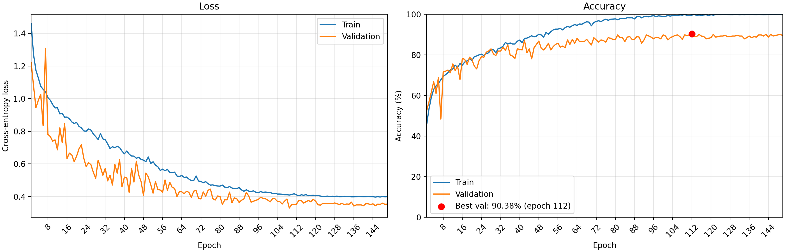

# 基于手写 ResNet50 的花卉图像分类

本项目使用 PyTorch 的基础模块，自行实现 ResNet50，完成五类花卉图片的分类。

模型从随机初始化开始训练，不调用现成的 ResNet50，也不使用 ImageNet 等外部预训练权重。数据增强使用 torchvision 提供的图像变换。


## 1. 项目结构

项目可以放在任意目录，以下以 `flower-class` 作为项目文件夹名称：

```text
flower-class/
├── config.py             # 训练配置及默认参数
├── datasets.py           # 数据读取、类别映射和数据划分
├── models.py             # 手写 Bottleneck 和 ResNet50
├── engine.py             # 单轮训练与评估
├── experiment.py         # 实验目录、配置和指标保存
├── train.py              # 训练入口
├── test.py               # 测试集评估入口
├── predict.py            # 单张图片预测入口
├── plot_history.py       # 训练曲线绘制入口
├── environment.yml       # Conda 环境说明
├── flower_photos/        # 图片数据集
└── runs/                 # 实验记录和模型检查点
```

## 2. 数据集划分

当前使用约 80% / 10% / 10% 的比例，分别作为训练集、验证集和测试集。

划分时先按类别分组，再在每个类别内部随机打乱并取整，因此实际数量为：

| 类别 | 训练集 | 验证集 | 测试集 |
|---|---:|---:|---:|
| daisy | 506 | 63 | 64 |
| dandelion | 718 | 89 | 91 |
| roses | 512 | 64 | 65 |
| sunflowers | 559 | 69 | 71 |
| tulips | 639 | 79 | 81 |
| 合计 | 2934 | 364 | 372 |

数据划分种子与训练随机种子 `2026` 。

三个子集分别承担以下任务：

- 训练集用于更新模型参数。
- 验证集用于选择训练方案和最佳模型。
- 测试集用于评估选定模型的最终表现。

## 3. 运行环境

已验证的参考运行环境如下：

| 项目 | 环境信息 |
|---|---|
| Python | 3.12 |
| PyTorch | 2.7.1+cu118 |
| CUDA 运行时 | 11.8 |
| GPU | Tesla V100-PCIE-16GB |
| NVIDIA 驱动 | 535.54.03 |

在项目根目录下创建环境：

```bash
conda env create -f environment.yml
conda activate flower
```

安装此前使用的 PyTorch 版本及配套 torchvision：

```bash
python -m pip install torch==2.7.1 torchvision==0.22.1 --index-url https://download.pytorch.org/whl/cu118
```

已有可正常运行的 `flower` 环境可以继续使用，无需重复创建。

## 4. 训练配置与训练方法

| 参数 |       默认值 | 含义 |
|---|----------:|---|
| `batch_size` |        16 | 每个训练批次的图片数量 |
| `num_workers` |         2 | 数据加载工作进程数量 |
| `learning_rate` |    0.0005 | 初始学习率 |
| `num_epochs` |       100 | 训练轮数 |
| `seed` |      2026 | 训练随机种子 |
| `momentum` |       0.9 | SGD 动量 |
| `weight_decay` |    0.0005 | 权重衰减 |
| `min_lr` | 0.0000001 | 余弦退火的最低学习率 |
| `label_smoothing` |       0.1 | 训练标签平滑系数 |

命令行支持覆盖训练轮数、批次大小、初始学习率、工作进程数量和训练随机种子。其他参数在配置文件中设置。

## 5. 使用方法

以下命令均在项目根目录下执行，即包含 `train.py` 和 `environment.yml` 的目录。运行前应激活 `flower` 环境，并确保数据集位于项目目录下。

示例中的 `runs/20261022_183745` 为已记录的实验目录；使用自己训练的模型时，请替换为实际生成的实验目录。测试和预测需要该目录中的 `best.pt`，权重文件默认不随源码仓库上传。

### 5.1 训练模型

使用当前默认配置：

```bash
python train.py
```

显式指定部分训练参数：

```bash
python train.py \
  --epochs 100 \
  --batch-size 16 \
  --lr 0.0005 \
  --num-workers 2 \
  --seed 2026
```

未通过命令行指定的参数仍采用当前配置文件中的值。上述命令不等同于精确复现历史最佳实验。

### 5.2 测试指定模型

`test.py` 的 `--checkpoint` 参数接收实验目录，程序会在目录后自动拼接 `best.pt`：

```bash
python test.py \
  --checkpoint runs/20261021_213701
```

程序输出模型轮次、保存的验证准确率、测试集数量、测试损失和测试准确率。

### 5.3 预测单张图片

`predict.py` 的 `--checkpoint` 参数接收实验目录，程序会在目录后自动拼接 `best.pt`：

```bash
python predict.py \
  --checkpoint runs/20261021_213701 \
  --image flower_photos/daisy/391364011_5beaaa1ae2_m.jpg
```

程序输出预测类别编号、类别名称和 softmax 概率。

softmax 概率表示模型在当前五个类别之间分配的概率，不代表经过校准的正确率。模型也没有实现未知类别识别。

### 5.4 绘制训练曲线

```bash
python plot_history.py \
  --run-dir runs/20261021_213701
```

绘图使用 `Agg` 后端，适合没有图形界面的服务器。

图片保存到对应实验目录中的 `training_curves.png`。

## 6. 实验文件与模型保存

每次训练创建一个以时间命名的实验目录，例如：

```text
runs/20261021_202511/
├── config.json
├── history.csv
├── best.pt
└── training_curves.png
```

其中：

- `config.json`：启动训练时采用的配置。
- `history.csv`：每轮训练和验证的指标。
- `best.pt`：验证准确率最高的检查点。
- `training_curves.png`：运行绘图脚本后生成的曲线图片。

## 7. 已验证的实验结果

目前保留的最佳实验为 `20261021_213701`。

已核对该实验的配置、100 轮训练记录及检查点元数据，最佳结果一致：

| 指标                |        结果 |
| ------------------- | ----------: |
| 最佳轮次            |   第 112 轮 |
| 最佳验证准确率      | 90.38 **%** |
| 验证集正确预测数量  |   328 / 364 |
| 该轮训练准确率      |      99.59% |
| 该轮验证损失        |      0.3534 |
| 第 150 轮验证准确率 |      89.56% |

这说明训练到最后一轮并不一定得到最佳验证结果，因此预测和测试应加载保存的最佳检查点。


该实验记录的主要参数为：

| 参数 |     记录值 |
|---|--------:|
| 批次大小 |      16 |
| 数据加载工作进程 |       2 |
| 初始学习率 |  0.0005 |
| 训练轮数 |     150 |
| 训练随机种子 |    2026 |
| ADAM betas | (0.9, 0.999) |
| 权重衰减 |  0.0005 |
| 最低学习率 | 1e-7 |
